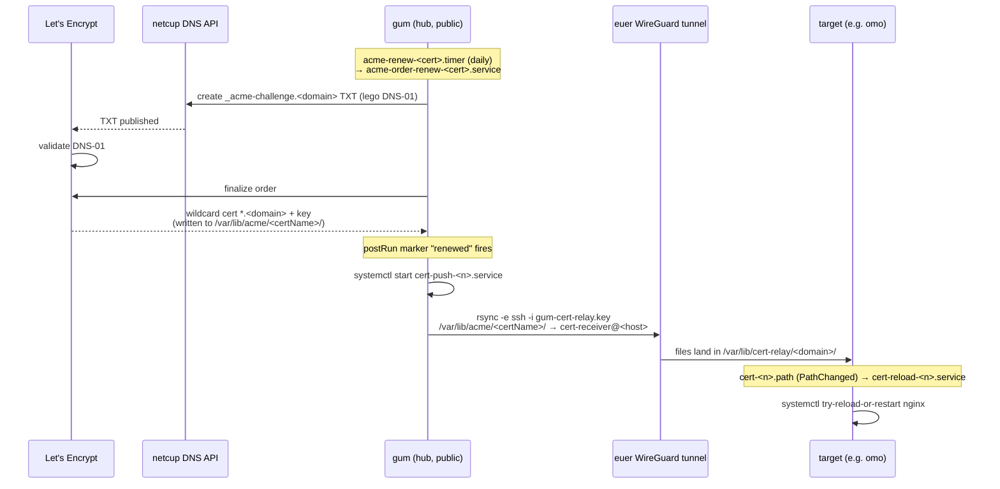
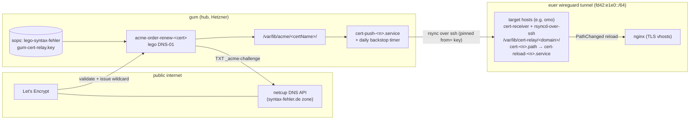

# Internal DNS Certificates (cert-relay)

How hosts in the internal networks (`euer` WireGuard mesh, office LAN) get real
Let's Encrypt TLS certificates, how the certificates flow from issuance to the
service that terminates TLS, and what to do when a new internal client needs a
certificate.

The machinery lives in the `~/nixos-config` flake:

| Piece | Path |
|---|---|
| Module (server + client halves) | `3modules/cert-relay.nix` |
| Domain instantiation: euer | `2configs/cert-relay/euer.nix` |
| Domain instantiation: lan | `2configs/cert-relay/lan.nix` |
| Push side config (gum) | `2configs/cert-relay/server-euer.nix`, `server-lan.nix` |
| Pull/receive side config (targets) | `2configs/cert-relay/client-euer.nix`, `client-lan.nix` |
| lego 5.6.0 overlay (netcupv1 provider) | `6hotfix/lego.nix` |
| euer WireGuard peer table + hosts entries | `2configs/wireguard/euer/common.nix` |

This repo (`infra`) hosts the public `cybahn.de` services, which use plain
`enableACME` (TLS-ALPN/HTTP-01) and are **not** part of cert-relay.

## The problem

Internal hosts (`*.euer`, LAN services on omo/wbob) are behind NAT or only
reachable over the euer WireGuard tunnel (ULA `fd42:e1e0::/64`,
`172.27.70.0/24`), so Let's Encrypt cannot validate them with HTTP-01.
Running ACME with a DNS-01 challenge on every host would mean replicating the
netcup API credentials everywhere and hammering LE with per-host orders.

## The solution

One hub — **gum** (public Hetzner server, euer endpoint
`142.132.189.140` / `fd42:e1e0::1`) — does all the ACME work:

1. `security.acme.certs.<certName>` on gum requests a **wildcard** certificate
   `*.<domain>` with **DNS-01** via lego's netcup DNS provider.
2. On successful issuance/renewal the cert is **pushed** with rsync-over-ssh
   to each target host through the euer WireGuard tunnel.
3. On the target, a systemd **path unit** notices the new files and reloads
   nginx, which terminates TLS with the real LE cert.

Two wildcard domains are currently relayed:

| Instance | Cert | SAN | dnsProvider | Notes |
|---|---|---|---|---|
| `euer` | `euer-syntax-fehler-wildcard` | `*.euer.syntax-fehler.de` | `netcup` (legacy session API) | targets reachable via `*.euer` hosts entries |
| `lan` | `lan-syntax-fehler-wildcard` | `*.lan.syntax-fehler.de` | `netcup` (legacy session API) | public wildcard A record → `192.168.111.11` (omo LAN lease) |

> `syntax-fehler.de` is not (yet) on netcup CloudDNS (`isDnsManaged: false` on
> the v1 API), so both instances use the legacy `netcup` provider. After a
> CloudDNS migration flip `dnsProvider = "netcupv1"` in the instantiation
> files. `netcupv1` needs lego ≥ 5.6.0; until nixpkgs carries the bump,
> `6hotfix/lego.nix` overlays it.

## Certificate flow



## Transfer details (what pins what)

### Push side (gum)

- ACME cert per instance: `security.acme.certs.<certName>` with
  `domain = "*.<domain>"`, `dnsProvider`, `renewInterval = "daily"`,
  `environmentFile = /run/secrets/lego-syntax-fehler` (netcup API
  credentials: `NETCUP_API_KEY_ID`, `NETCUP_API_SECRET`, customer number).
- `postRun` starts `cert-push-<n>.service`, which rsyncs the whole
  `/var/lib/acme/<certName>/` directory to every `server.targets` host
  (euer-resolvable names, e.g. `omo.euer`) as user `cert-receiver`.
- Auth: dedicated ssh keypair. Private half is the clan/sops secret
  `gum-cert-relay.key` (decryptable on gum only); public half is pinned in the
  instantiation files as `pubKey` and installed into
  `~cert-receiver/.ssh/authorized_keys` on every target with

  ```
  from="fd42:e1e0::1,172.27.70.1",restrict,no-agent-forwarding,no-X11-forwarding,no-pty
  ```

  → only gum's euer endpoints may push, only rsync, no shell.
- `StrictHostKeyChecking=accept-new` with known_hosts in
  `/var/lib/cert-relay` (tmpfiles-created, 0700 root).
- **Backstop timer** `cert-push-<n>.timer` (`daily`, `Persistent=yes`,
  `RandomizedDelaySec=3600`): a target that was offline at renewal time
  catches up within a day **without re-issuing** (rsync is idempotent;
  PathChanged only fires on actual file change).

### Receive side (each target)

- `/var/lib/cert-relay/<domain>/` — mode `2770`, `root:nginx`, so
  `cert-receiver` can replace files (unlink needs dir write, not ownership)
  and nginx can read the `0640` key. rsync uses `--chmod=D2770,F0640` and
  skips owner/group/mtime flags.
- User `cert-receiver` (system user, groups `cert-receiver` + `nginx`, real
  bash shell — nologin would break rsync's remote side).
- `cert-<n>.path`: `PathChanged=/var/lib/cert-relay/<domain>` → triggers
  `cert-reload-<n>.service` → `systemctl try-reload-or-restart <reloadUnits>`
  (default `nginx.service`). rsync writes to temp files and renames into
  place, so the reload sees complete files.
- nginx runs `ProtectSystem=strict`; the module adds
  `ReadWritePaths=/var/lib/cert-relay` to `nginx.service`.
- **Bootstrap placeholders**: `services.nginx.preStart` generates a self-signed
  `key.pem`/`fullchain.pem` (`-days 1`, CN `*.<domain>`) if the dir is empty,
  so nginx starts before the first push; the relayed cert replaces it and the
  path unit reloads.
- Firewall: targets open 443 themselves (they terminate real-TLS vhosts).

### Naming / DNS resolution

- `*.euer` hostnames (`omo.euer`, `gum.euer`, …) resolve via `/etc/hosts`
  entries generated from the peer table in `2configs/wireguard/euer/common.nix`
  (ULA + ipv4 per peer). New euer peer = new `makefu.euer-wg.peers` entry.
- `*.lan.syntax-fehler.de` is a **public wildcard A record in netcup DNS**
  pointing at `192.168.111.11` (omo's LAN lease), so LAN clients can reach the
  serving host by FQDN; LAN-only names (`foo.euer`/`foo.lan` short forms) come
  from the router's `*.lan` wildcard + AdGuard Home
  (`2configs/home/adguard.nix`).
- The ACME `_acme-challenge.<domain>` TXT records are ephemeral, created and
  deleted by lego through the netcup API — never hand-managed.


## Topology



ASCII fallback:

```
                 TXT _acme-challenge.*                DNS-01 validate + issue
   gum ──────────────────────────────► netcup DNS ◄──────────────── Let's Encrypt
    │  (lego, sops: lego-syntax-fehler)                                  │
    │                                                                    ▼
    │                        /var/lib/acme/<certName>/  ◄──── wildcard cert *.<domain>
    │                                │
    │    postRun / daily timer       ▼
    └─► cert-push-<n>.service ── rsync over ssh (gum-cert-relay.key,
                                 from="fd42:e1e0::1,172.27.70.1",restrict)
                                         │  euer wireguard tunnel
                                         ▼
                 target: /var/lib/cert-relay/<domain>/ ── PathChanged ──► nginx reload
```

## Consumer example (omo)

`2configs/home/nostr-relay.nix` / `nostr-files.nix` import the four
cert-relay files (shared instantiation + client for both domains) and define
vhosts like:

```nix
"nostr.euer.syntax-fehler.de" = {
  onlySSL = true;
  sslCertificate = "/var/lib/cert-relay/euer.syntax-fehler.de/fullchain.pem";
  sslCertificateKey = "/var/lib/cert-relay/euer.syntax-fehler.de/key.pem";
  ...
};
```

Plain-HTTP vhosts (`nostr.euer`, `nostr.lan`) coexist for wireguard/LAN-only
consumers that don't need TLS.

## Runbook: adding a new internal client/service that needs HTTPS

### Case A — new vhost on a host that already receives certs (e.g. another service on omo)

Cheapest path; nothing to issue, the wildcard already covers it.

1. Pick the FQDN under an existing wildcard: `foo.euer.syntax-fehler.de`
   and/or `foo.lan.syntax-fehler.de`.
2. **netcup DNS**: the wildcard A records already exist
   (`*.lan.syntax-fehler.de` → `192.168.111.11`). Nothing to add **if** the
   new service is served by the host the wildcard points at. If it is served
   from a different LAN IP, either proxy through that host or add an explicit
   A record `foo.lan.syntax-fehler.de → <new-host-lan-ip>` in the netcup DNS
   console (or an AdGuard rewrite for LAN-only names).
3. Import the client modules on the host (idempotent if already present):

   ```nix
   imports = [
     ../../2configs/cert-relay/client-euer.nix   # + ../cert-relay/euer.nix
     ../../2configs/cert-relay/client-lan.nix
   ];
   ```
4. Point the nginx vhost at `/var/lib/cert-relay/<domain>/{fullchain,key}.pem`
   (see nostr-relay above).
5. Rebuild. If the cert on disk might be stale, re-trigger the push (not the
   issuance): on gum run `systemctl start cert-push-lan.service`
   (`cert-push-euer.service` for the euer domain).

### Case B — brand-new target host in euer/LAN

1. Join the host to euer: add it to `makefu.euer-wg.peers` in
   `2configs/wireguard/euer/common.nix` (ULA, ipv4, publicKey; `publicV6` +
   `openTCPPorts` only if it must be reachable from the internet). Its
   `<name>.euer` hosts entry and the wireguard peer config follow from the
   module `3modules/euer-wg.nix`.
2. Import `2configs/cert-relay/client-euer.nix` / `client-lan.nix` on the new
   host. This creates `cert-receiver`, the pinned authorized key, the relay
   dirs, the path/reload units, and the placeholder logic.
3. Add the euer-resolvable hostname (e.g. `newhost.euer`) to
   `makefu.cert-relay.<n>.server.targets` in the corresponding
   `2configs/cert-relay/server-<n>.nix` on gum.
4. Secrets: make sure the sops/clan secrets `lego-syntax-fehler` and
   `gum-cert-relay.key` stay decryptable on **gum** (targets need no netcup
   credentials — that is the point of the relay).
5. Rebuild both sides, then force the first push immediately:

   ```bash
   ssh gum systemctl start cert-push-lan.service cert-push-euer.service
   ```

   Verify on the target:

   ```bash
   ls -l /var/lib/cert-relay/lan.syntax-fehler.de/
   systemctl status cert-reload-lan.service
   journalctl -u 'cert-push-*' -u 'acme-*'   # on gum
   ```

### Case C — completely new internal domain (e.g. `*.lab.syntax-fehler.de`)

1. **netcup DNS**: create (or keep) a wildcard A record for the new
   subdomain (`*.lab.syntax-fehler.de → <serving-host-ip>`) so clients can
   resolve it; the `_acme-challenge` TXT records stay fully automated.
2. New instantiation file `2configs/cert-relay/lab.nix` setting
   `makefu.cert-relay.lab = { domain = "lab.syntax-fehler.de"; certName =
   "lab-syntax-fehler-wildcard"; dnsProvider = "netcup"; pubKey = …; }`
   (`certName` must not contain `*`; it defaults to dots→dashes of the domain).
3. Server half on gum (`server-lab.nix` with `targets`), client half on each
   target host. Both sides import the same instantiation file so names/paths
   agree (NixOS dedupes module imports by path).
4. If the zone ever moves to netcup CloudDNS, set `dnsProvider = "netcupv1"`
   and confirm the lego overlay (`6hotfix/lego.nix`) still applies.

## Re-triggering timers / recovery

| Need | Command (on the relevant host) |
|---|---|
| Force cert push now (no re-issue) | `systemctl start cert-push-<n>.service` on gum |
| Force ACME order/renew now | `systemctl start acme-order-renew-<certName>.service` on gum (posts `renewed` marker → postRun pushes) |
| Full cert redelivery to one host | rsync runs as a unit; re-start `cert-push-<n>.service`, rsync re-copies changed files, PathChanged reloads nginx |
| Target was offline during renewal | nothing — `cert-push-<n>.timer` (daily, `Persistent=yes`) catches it up within a day |
| nginx started before first push | placeholder self-signed cert is expected; journal shows reload once the real cert lands |
| Inspect what LE issued | `journalctl -u 'acme-*'` on gum; certs in `/var/lib/acme/<certName>/` |

## Gotchas

- `certName` keys for `security.acme.certs` must be `*`-free (nixpkgs
  assertion) — hence `lan-syntax-fehler-wildcard` for `*.lan.syntax-fehler.de`.
- The per-instance attrset iteration must only appear in option **values**
  under statically-named keys (`systemd.services`, `security.acme.certs`, …);
  a top-level `mkMerge` over the config attrset trips the module system (see
  comment in `3modules/cert-relay.nix`).
- `cert-receiver` needs a real shell despite `restrict` — `nologin` kills
  rsync's remote server.
- Relay dirs are group-writable (`2770`) rather than sticky so the receiver
  can replace placeholder files it doesn't own.
- netcup API errors / `isDnsManaged:false` → you are on the wrong provider
  variant (`netcup` vs `netcupv1`).
